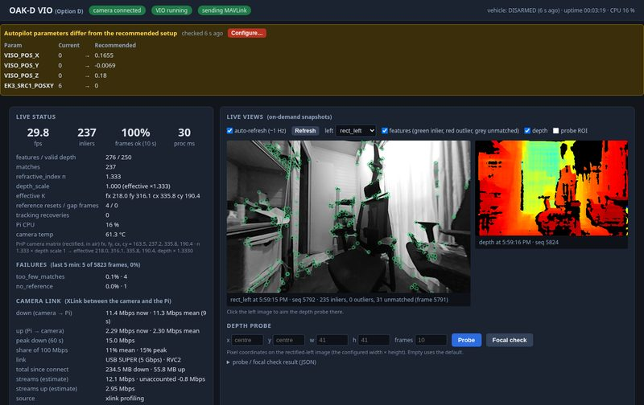

# OAK-D VIO

A [BlueOS](https://github.com/bluerobotics/BlueOS) extension that uses a Luxonis OAK-D as a visual odometry sensor for ArduSub (ArduPilot EKF3).

The camera does the image work: stereo depth, feature tracking, and the depth at each tracked feature. The Raspberry Pi receives the features, their depth and the IMU, estimates the motion between frames, and sends `VISION_POSITION_DELTA` to the autopilot through BlueOS's mavlink2rest. Images cross the camera link only while someone is looking at them, JPEG-encoded on the camera.

## Supported cameras

USB and Ethernet (PoE) OAK-D cameras. Tested on an OAK-D (USB) and an OAK-D-W-PoE.

## Install

Install **OAK-D VIO** (`williangalvani.oakd-basalt`) from the BlueOS Extensions page, or from the image `williangalvani/blueos-oakd-basalt:v0.1.1`.

The page is at port **8095** on the vehicle (8080 is used by mavlink-server on BlueOS 1.4.x). The extension uses host networking, so a PoE camera on the same vehicle network is reachable without extra setup.

## Settings

The defaults, and the setup used for the measurements below, are 640×400 at 30 fps, with subpixel and the speckle filter on, and `depth_transport` set to `points` (depth at the features, computed on the camera). Live views are on demand.

## Autopilot parameters

The page checks the autopilot against a recommended set for position hold with `VISION_POSITION_DELTA` (ArduSub, EKF3). The check is read-only. The extension never writes parameters by itself.

A warning lists any differences. **Configure…** opens a dialog with the exact changes. Nothing is written until you confirm. The write is refused if the vehicle is armed, each value is read back, and parameters that need a reboot are listed. The extension never reboots the autopilot.

Recommended values:

- `AHRS_EKF_TYPE` = 3 and `EK3_ENABLE` = 1 (EKF3; needs a reboot if changed)
- `VISO_TYPE` = 1 (MAVLink visual odometry; needs a reboot for the other `VISO_*` parameters to appear)
- `VISO_POS_X` / `VISO_POS_Y` / `VISO_POS_Z` = 0.1655, −0.0069, 0.18 m, FRD, from the CAD of this vehicle's camera mount. EKF3 applies this lever arm itself. Use the lever arm of your own mount if it is different.
- `VISO_ORIENT` = 0 (the extension already rotates into body FRD)
- `EK3_SRC1_VELXY` = 6 (ExternalNav)
- `EK3_SRC1_POSXY` = 0 (None). Body-frame odometry is fused as velocity; `POSXY` = 6 would wait for an absolute `VISION_POSITION_ESTIMATE` that this extension does not send.
- `EK3_SRC1_POSZ` = 1 (Baro / depth)
- `EK3_SRC1_VELZ` = 0
- `EK3_SRC1_YAW` = 1 (compass; the deltas carry no heading)

`VISO_DELAY_MS` is left as it is; it has not been tuned from logs.

## Camera link

At 640×400, 30 fps, `points` mode, we measured:

- USB 3 (dev vehicle, lit indoor scene): about 9.2–9.6 Mbps down and 2.2–2.3 Mbps up
- 100 Mbps Ethernet (OAK-D-W-PoE on a BlueROV, in a pool): about 2.0–2.7 Mbps down and 0.5 Mbps up

The fallback `full_frame` mode (sending every depth frame to the Pi) was 127.5 Mbps down at 30 fps, which does not fit a 100 Mbps PoE link.

## Limitations

- The tracker needs texture. In a murky pool looking at a mostly featureless floor we had about 50 features and 30 inliers, versus about 230 inliers in a lit office, and it took about 70 s to lock after a restart in that test.
- With subpixel on, the camera tops out around 31 fps, even if 45 or 60 is requested.
- Scale against a DVL has not been verified on this version.
